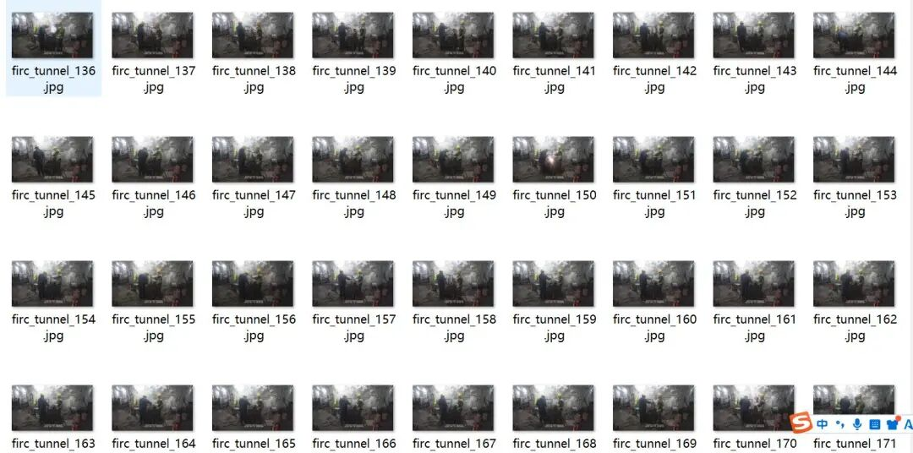
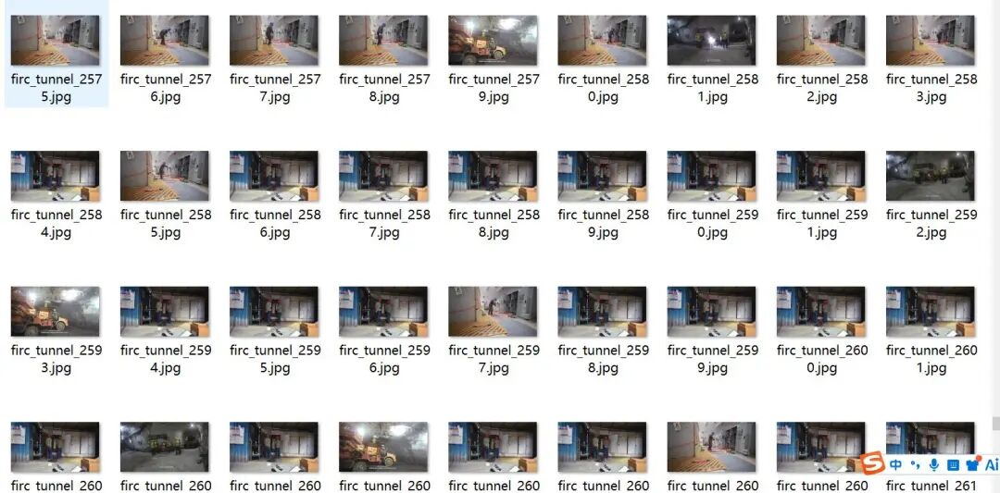
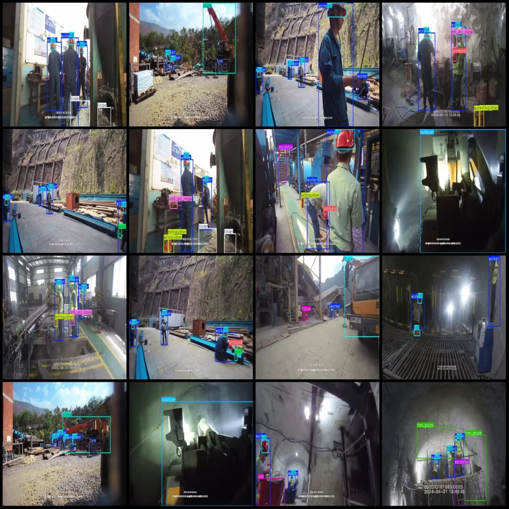
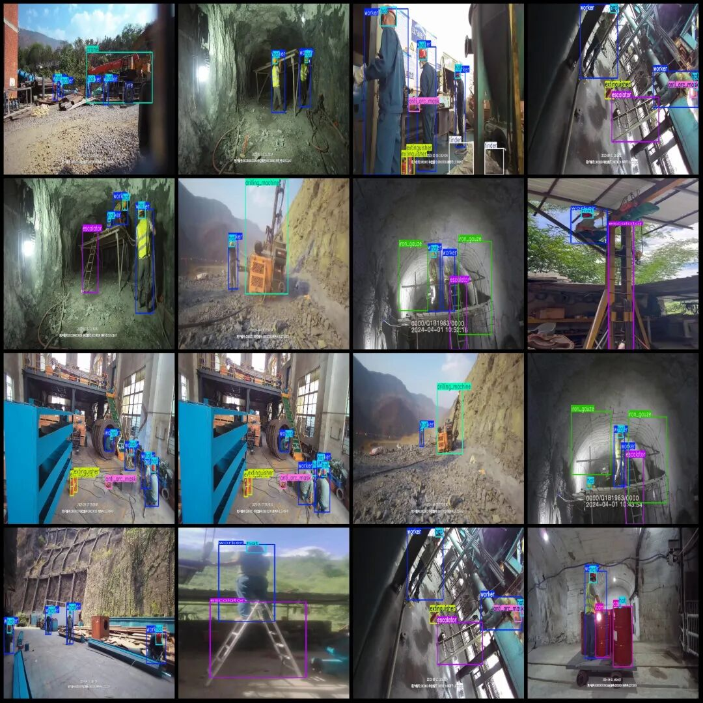

# Pipeline Construction Objective Detection Dataset VOC+YOLO format with 3012 images and 19 categories

Dataset format: Pascal VOC format + YOLO format (txt file without split path, only containing jpg images and corresponding VOC format xml files and yolo format txt files)

Number of images (number of jpg files): 3012

Number of annotations (number of xml files): 3012

Number of annotations (number of txt files): 3012

Labeling category count: 19

Label category names (Note that the order of yolo format categories does not correspond to this, but is based on the classes.txt in the labels folder): ["anti_arc_mask", "armband", "bulldozer", "can", "crane", "discharge_table", "distribution_box", "drilling_machine", "escalator", "extinguisher", "hat", "iron_gauze", "loader", "paint", "spark", "tinder", "truck", "tyre", "worker"]

Number of boxes and image footprints per category:

Anti-arc mask (anti-arc face shield) frame count = 567, occupied image count = 475.

Armband (armband/sleeve) frame count = 552, occupying picture count = 552.

Bulldozer (Backhoe) frame count = 237, occupying picture count = 237.

Can (jar/bucket) frame count = 447, occupying picture count = 294.

Crane (crane) frame count = 131, occupying picture count = 131.

Discharge table (discharge table/discharge platform) frame count = 234, occupying picture count = 234.

Distribution box (distribution box) frame count = 162, occupying picture count = 101.

Drilling Machine (Drilling Machine) Frame Count = 223, Pictures Occupied = 223.

Escalator (automatic escalator) frame count = 681, occupying picture count = 641.

Extinguisher (fire extinguisher) frame count = 1289, occupying picture count = 834.

Number of hat (helmet) frames = 4905, Number of pictures occupied = 2305.

Iron gauze (wire mesh/iron net) frame count = 417, occupying picture count = 225.

Loader (loader) frame count = 23, occupying picture count = 23.

Paint (paint) frame count = 70, occupy picture count = 70.

Spark (spark) frame count = 208, occupying picture count = 208.

Tinder (fire starter/igniter) frame count = 483, image count = 257.

Truck (truck) frame count = 576, occupying picture count = 545.

Tyre (tire) frame count = 306, occupying picture count = 211.

Worker (worker) frame count = 5575, occupied image count = 2545.

Total frame count: 17086

Image resolution: Multi-resolution images, such as 480x848, 854x480, etc.

Using labelImg:

Annotation rules: Draw a rectangle around the category.

Important Notice: The dataset does not have separate training, validation, and test sets; you need to partition them yourself.

Special : This dataset does not guarantee the accuracy of the trained models or weight files.

Image Preview:

Annotation example:

## Payment

Here is a pay link on Stripe ( https://buy.stripe.com/3cs8yP7sY87d0vu9AB ). Please contact me lonlonago@foxmail.com after funding $89, and I will send you a complete data files , thank you!

